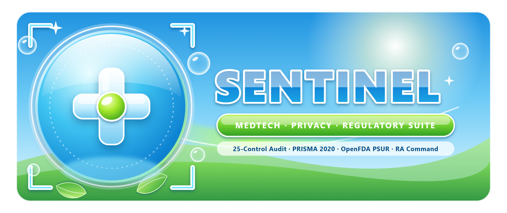

<div align="center">
  
</div>

# OpenFDA MAUDE & ClinicalTrials.gov CLI Utility

**Open-source Python CLI for querying public FDA MAUDE adverse-event counts, recalls, 510(k) clearances, and ClinicalTrials.gov v2 studies into structured Excel and Word tables.**

[](https://www.python.org/)
[](https://opensource.org/licenses/MIT)
[](#overview)

> **100% Free & Open-Source CLI Utility (MIT):** Built as a student data-engineering project to parse public OpenFDA & ClinicalTrials.gov v2 JSON APIs. *(See also the flagship research repo: [`computational-biology-portfolio`](https://github.com/kaledbouchagraoui7-bot/computational-biology-portfolio).)*

---

## Overview

Under **EU MDR 2017/745 Articles 83–86** and **MDCG 2022-21**, medical device manufacturers and Clinical Research Organizations (CROs) must continuously monitor similar/competitor devices across **FDA MAUDE (adverse events, recalls, 510(k) clearances)** and **`ClinicalTrials.gov` (ongoing PMCF and competitor clinical investigations)** to compile their **Periodic Safety Update Report (PSUR)** and **Clinical Evaluation Report (CER)** updates.

`pms_monitor.py` automates public-registry data collection and produces a reproducible starting **PMS / PSUR Draft Dossier**:

1. **Landscape Word PSUR Safety & Clinical Trial Report (`.docx`)** — Pre-formatted tables covering MAUDE adverse event severity (`Malfunction`, `Injury`, `Death`), FDA recalls & 510(k) clearances, and tracked `ClinicalTrials.gov` studies.
2. **4-Sheet Filterable Excel Surveillance Workbook (`.xlsx`)** — `MAUDE_Adverse_Events`, `Recalls_and_510k`, `ClinicalTrials_Landscape` (with clickable `https://clinicaltrials.gov/study/<NCTId>` hyperlinks), and `README`.
3. **300-DPI Visual PMS & Clinical Landscape Dashboard (`.png` & `.pdf`)** — High-resolution executive chart ready to inspect in PSUR reviews.
4. **Zipped Deliverable Package (`<slug>_dossier.zip`)**.

## Automation Boundaries: What Code Does vs. Human Judgment

| What `pms_monitor.py` Automates (Deterministic) | What Requires Qualified Human Judgment (PRRC / Clinician) |
|---|---|
| Pulling live OpenFDA MAUDE event counts, 510(k) clearances, recalls, and ClinicalTrials.gov v2 study statuses | Clinical causality assessment, IMDRF Annex coding validation, and serious-incident reportability decisions |
| Computing monthly rolling volume trends and Z-score flags for review (raw counts, not incidence rates) | Determining whether a spike reflects true device degradation, denominator shifts, or reporting lag/batch artifacts |
| Automating the mechanical formatting of ALCOA+ Word, Excel, and visual draft packs | Operator setup, verification time, benefit-risk determination, and final EU MDR PSUR/PMCF clinical sign-off |

---

## Quickstart

### 1. Install Dependencies

```bash
pip install -r requirements.txt
```

### 2. Generate Dossier from Sample Snapshot (Deterministic Demo)

```bash
python pms_monitor.py --input sample_pms_input.json --output-dir examples
```

### 3. Query Live OpenFDA + ClinicalTrials.gov APIs

```bash
python pms_monitor.py --live-device "insulin pump" --live-condition "type 1 diabetes" --output-dir output
```

### 4. Run Automated Unit Tests

```bash
python -m unittest discover -p "test_*.py" -v
```

---

## Public Dataset Case Study

- **[Case Study 01 — Insulin Infusion Pumps (`n = 2,056,124` MAUDE MDRs)](case_studies/01_insulin_pump_maude_zscore_study.md)** · ([Reproducible Notebook](case_studies/01_insulin_pump_maude_zscore_study.ipynb)): Evaluates trailing-baseline Z-score sensitivity (`12m` vs. `35m`), noting July reporting volumes (`2024-07` at `Z = +5.11`; `2025-07` at `Z = +2.10`) **flagged for review** (raw counts, not incidence rates) alongside PRRC clinical boundaries.

## Data Source Terms & Legal Compliance

- **ClinicalTrials.gov API v2**: Subject to NLM/NIH terms at https://clinicaltrials.gov/
- **OpenFDA API**: Public domain (CC0 1.0) subject to terms at https://open.fda.gov/apis/ and https://open.fda.gov/license
- See [`LEGAL_COMPLIANCE_AND_ETHICS.md`](LEGAL_COMPLIANCE_AND_ETHICS.md) for complete Swiss (`StGB`, `UWG`, `nFADP`) and EU (`MDR`, `GDPR`) operational, data-integrity, and outreach compliance rules.
