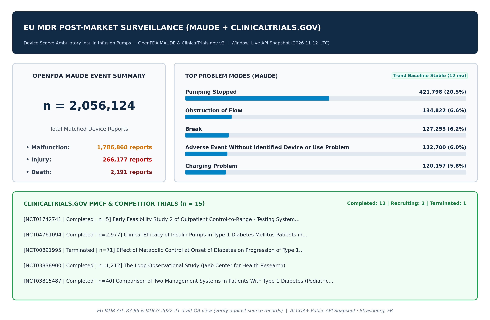

# Case Study 01: Quantitative Signal Triage & Trailing-Baseline Sensitivity in Ambulatory Insulin Infusion Pumps (OpenFDA MAUDE + ClinicalTrials.gov v2)

**Regulatory Alignment:** EU MDR 2017/745 Articles 83–86 (PMS / PSUR) · MDCG 2022-21 · FDA 21 CFR Part 803  
**Reproducibility Script:** [`run_insulin_pump_case_study.py`](run_insulin_pump_case_study.py)  
**Live Snapshot Dataset:** [`artifacts/insulin_pump_live_dataset.json`](artifacts/insulin_pump_live_dataset.json)  

---

## 1. Objective & Research Question

In Post-Market Surveillance (PSUR / PMCF) for Class IIb active infusion systems, regulatory teams routinely monitor public FDA MAUDE Medical Device Reports (MDRs) alongside active clinical investigations on `ClinicalTrials.gov`. A common practical pitfall in automated trend scripts is choosing too short a trailing baseline window (e.g., 12 months), which can absorb genuine seasonal or batch spikes into the burn-in period.

Using purely public, zero-cost APIs (`api.fda.gov/device/...` and `clinicaltrials.gov/api/v2/studies`) on **2026-11-12 UTC**, we evaluated:
1. Total historical MDR volume and failure-mode distribution across **Ambulatory Insulin Infusion Pumps** (`2,056,124` analyzed reports).
2. Whether extending the monthly `date_received` series from `12` months to `35` complete months (`2023-11` through `2026-09`) alters anomaly detection sensitivity at `Z >= 2.0` (`compute_maude_signal_spikes`).

---

## 2. Empirical Results (Snapshot: 2026-11-12 UTC)

### 2.1 Overall Severity & Problem Mode Distribution (`n = 2,056,124`)

| Event Outcome / Problem Category | Observed Count | Share (%) | Regulatory Triage Note |
|---|---:|---:|---|
| **Malfunction** | `1,786,860` | `86.9%` | Predominantly mechanical/occlusion/alarm events |
| **Injury** | `266,177` | `12.9%` | Hyperglycemia/DKA or hypoglycemia risk vectors |
| **Death** | `2,191` | `0.11%` | Mandatory individual narrative review; MAUDE reports do not establish causation alone |
| **Top Mode #1 — Pumping Stopped** | `421,798` | `20.5%` | Primary hardware/delivery interruption mode |
| **Top Mode #2 — Obstruction of Flow** | `134,822` | `6.6%` | Infusion set / cannula / basal delivery occlusion |
| **Top Mode #3 — Break** | `127,253` | `6.2%` | Housing, cartridge, or mechanical structural failure |
| **Top Mode #4 — Unidentified Device/Use Problem** | `122,700` | `6.0%` | Coding gap highlighting reporter narrative dependency |
| **Top Mode #5 — Charging Problem** | `120,157` | `5.8%` | Battery/power subsystem degradation |
| **Top Mode #6 — Incorrect Measurement** | `117,385` | `5.7%` | Integrated CGM / bolus calculator sensor discrepancy |

### 2.2 Trailing Baseline Sensitivity (`12-Month Default` vs. `35-Month Extended`)

Running `compute_maude_signal_spikes(..., z_threshold=2.0)` over the default `12`-month trailing window (`2025-11` to `2026-10`, `min_baseline=3`) returned **`0` alerts** because the local peak (`2025-12` at `24,915` reports vs. ~`19.6k–21.5k` baseline) fell at index `1` inside the `min_baseline=3` warm-up slice.

Extending retrieval to **35 complete trailing months (`2023-11`–`2026-09`, `min_baseline=6`)** surfaced **two clear mid-summer volume spikes**:

| Alert Month | Monthly MDRs | Trailing Mean | Trailing SD | Z-Score | % Above Mean | Status |
|---|---:|---:|---:|---:|---:|---|
| **`2024-07`** | `28,819` | `20,683.2` | `1,591.13` | **`+5.11`** | `+39.3%` | `TREND_SPIKE_ALERT` |
| **`2025-07`** | `30,275` | `22,793.2` | `3,560.17` | **`+2.10`** | `+32.8%` | `TREND_SPIKE_ALERT` |

*Key quantitative observation (flagged for review):* Both `Z >= 2.0` excursions (`2024-07` and `2025-07`) fall in July and are **flagged for investigation**, not treated as a device-safety conclusion. Because MAUDE captures raw report counts affected by reporting lags, batch filings, and installed-base changes—never incidence rates—a qualified PRRC must check internal sales/complaint denominators and full MDR narratives before drawing clinical conclusions.

### 2.3 Parallel 510(k) & ClinicalTrials.gov v2 Landscape

- **Recent Predicate 510(k) Clearances Surfaced (`n = 5`):** Includes *MiniMed 780G (`K253470`, 2026-01-15)*, *Tandem Mobi (`K253074`, 2025-11-06)*, and *t:slim X2 (`K250792`, 2025-09-24)* under Product Code `QFG`.
- **Active & Historical Clinical Landscape (`n = 15` sampled studies):** Spans large observational safety cohorts (`NCT04761094`, `n = 2,977`; `NCT03838900`, `n = 1,212`) through active recruiting skin-barrier & closed-loop trials (`NCT06856954`, `n = 150`; `NCT06880835`, `n = 30`).



---

## 3. Methodological Limitations & Required Human Judgment (PRRC Scope)

Quantitative Z-score triage over public registries is a **screening aid**, never a standalone clinical safety conclusion:

1. **Missing Exposure Denominators:** MAUDE captures raw event numerators without active patient-years or distributed unit counts. An apparent `2024-07` spike (`Z = +5.11`) can reflect market expansion, software release rollouts, or voluntary reporting campaigns rather than an increased per-device hazard rate.
2. **Notoriety & Weber Reporting Bias:** Regulatory recalls and publicized field safety notices predictably inflate subsequent passive report volumes.
3. **Duplicate & Pooled-Manufacturer Aggregation:** Broad `device.generic_name` queries pool distinct manufacturers unless stratified by `510(k)` number or Product Code (`QFG`).
4. **Final MDR / PRRC Determination:** Determining IMDRF Annex coding accuracy, clinical seriousness, and EU MDR Vigilance reportability strictly requires qualified **PRRC / Clinical Safety** review of underlying full-text MDR narratives and internal complaint-rate denominators.

---

## 4. Reproduce Locally (EUR 0.00 / No Paid Keys Required)

```bash
python case_studies/run_insulin_pump_case_study.py
```
